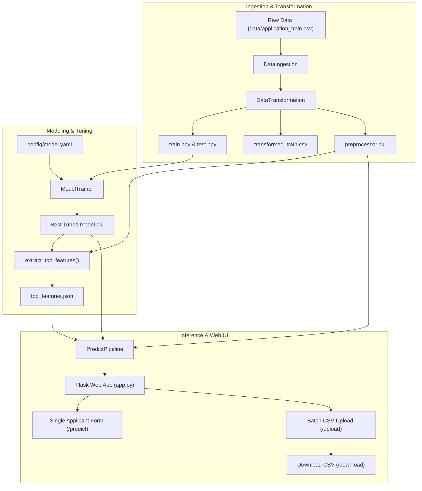

# 💳 Home Credit Default Risk Prediction - End-to-End ML System

[](https://www.python.org/)
[](https://flask.palletsprojects.com/)
[](https://scikit-learn.org/)
[](https://xgboost.readthedocs.io/)
[](LICENSE)

An end-to-end Machine Learning production system and Flask web application built to predict loan repayment difficulties for credit applicants. The project addresses the **Home Credit Default Risk** problem, enabling financial institutions to broaden credit inclusion to unbanked and underserved populations while minimizing credit default losses.

---

## 📌 Table of Contents

- [Business Problem](#-business-problem)
- [What Has Been Done in This Project](#-what-has-been-done-in-this-project)
- [Project Architecture & Workflow](#-project-architecture--workflow)
- [Directory Structure](#-directory-structure)
- [Step-by-Step Setup Guide (For Anyone Cloning)](#-step-by-step-setup-guide-for-anyone-cloning)
- [Running the Pipelines](#-running-the-pipelines)
- [Running the Web Application](#-running-the-web-application)
- [Testing Suite](#-testing-suite)
- [Model Details & Configuration](#-model-details--configuration)
- [Technologies Used](#-technologies-used)
- [License](#-license)

---

## 💼 Business Problem

Many potential borrowers struggle to obtain loans due to having insufficient or non-existent credit histories. Traditional credit scoring systems often reject viable candidates. Home Credit strives to expand financial inclusion for this unbanked population by utilizing alternative data sources and behavioral patterns.

In this project, we solve an **imbalanced binary classification problem**:
- `TARGET = 0`: Client with no payment difficulties (loan repaid / good credit).
- `TARGET = 1`: Client with payment difficulties (default risk / late payment).

By accurately predicting default probability, financial institutions can safely approve loans for worthy applicants while managing default risk.

---

## 🛠️ What Has Been Done in This Project

This repository contains a complete, production-ready machine learning lifecycle implementation:

### 1. 🔬 Exploratory Data Analysis & Prototyping (`notebooks/`)
- Analyzed the Home Credit dataset in `notebooks/home_credit.ipynb`.
- Investigated feature distributions, missing value densities, and target imbalance.
- Experimented with various classification models (Random Forest, XGBoost) and hyperparameter grids before modularizing into production code.

### 2. 📦 Data Ingestion Component (`src/components/data_ingestion.py`)
- Automatically reads raw datasets (`application_train.csv`, `application_test.csv`) from `data/`.
- Validates directories and copies raw data into the managed `artifacts/` folder for versioned pipeline processing.

### 3. ⚙️ Data Transformation Pipeline (`src/components/data_transformation.py`)
- Handles identifier column dropping (`SK_ID_CURR`).
- Splits dataset into 70% training and 30% testing sets using stratified logic.
- Implements dual feature processing pipelines:
  - **Numerical Pipeline**: Imputes missing values with `SimpleImputer(strategy="median")` and scales features using `RobustScaler` (resistant to financial outliers).
  - **Categorical Pipeline**: Imputes missing categories with `SimpleImputer(strategy="most_frequent")` and encodes categories with `OneHotEncoder(drop="first", handle_unknown="ignore")`.
- Exports transformed preprocessed numpy arrays (`train.npy`, `test.npy`), full transformed CSV files (`transformed_train.csv`, `transformed_test.csv`), and the serialized preprocessing pipeline (`preprocessor.pkl`).

### 4. 🤖 Model Training & Hyperparameter Tuning (`src/components/model_trainer.py`)
- Compares multiple base classification models:
  - `RandomForestClassifier`
  - `XGBClassifier`
  - `GradientBoostingClassifier`
- Automatically reads hyperparameter search spaces from `config/model.yaml`.
- Performs fine-tuning of the best-performing model using `GridSearchCV` with cross-validation.
- Validates model accuracy against configured acceptance thresholds before persisting the model to `artifacts/model.pkl`.

### 5. 📊 Top Feature Importance Extraction (`src/utils/extract_top_features.py`)
- Extracts the top $N$ most influential features from the trained model's feature importances (e.g. `EXT_SOURCE_3`, `DAYS_REGISTRATION`, `EXT_SOURCE_2`, `EXT_SOURCE_1`, `DAYS_ID_PUBLISH`, `DAYS_BIRTH`, `AMT_ANNUITY`, `AMT_GOODS_PRICE`).
- Calculates baseline feature means across the dataset and exports them to `artifacts/top_features.json` to enable intelligent single-applicant form filling.

### 6. 🔄 End-to-End Orchestration & Inference Pipelines (`src/pipeline/`)
- **Training Pipeline (`train_pipeline.py`)**: Sequentially executes Data Ingestion $\rightarrow$ Data Transformation $\rightarrow$ Model Training & Tuning $\rightarrow$ Top Feature Extraction in a single command.
- **Prediction Pipeline (`predict_pipeline.py`)**: 
  - **Single Prediction**: Accepts a dictionary of applicant features, imputes missing values using saved preprocessor pipelines, and outputs a risk classification.
  - **Batch CSV Prediction**: Reads an uploaded CSV dataset, runs batch inference, appends a predicted `TARGET` column mapped to `good` vs `bad`, outputs prediction statistics, and saves output to `artifacts/predictions/prediction_file.csv`.

### 7. 🌐 Full Flask Web Application (`app.py`, `templates/`)
- Responsive, modern user interface styled with **Bootstrap 5** and **Bootstrap Icons**:
  - **Single Prediction Form (`form.html`)**: Input form for top model indicators with human-readable labels, step guidance, a **"Fill Sample Data"** auto-fill button, and clear risk classification badges.
  - **Batch CSV Upload (`upload.html`)**: Drag-and-drop CSV upload, batch processing status, summary counters (Total, High Risk, Low Risk), preview table of the first 10 classified records, and a direct download link.
  - **Result Export (`/download`)**: One-click download of the generated prediction CSV file.

### 8. 🪵 Production Logging & Custom Exception Handling (`src/`)
- **Logging (`src/logger.py`)**: Timestamped log files generated in `logs/` capturing every step of pipeline execution and web request handling.
- **Custom Exceptions (`src/exception.py`)**: Custom error class capturing exact script names and line numbers for rapid debugging.

### 9. 🧪 Test Suite (`tests/`)
- Dedicated test scripts verifying each individual component and pipeline independently.

### 10. 🛡️ Git & Repository Optimization (`.gitignore`, `.gitattributes`)
- Excludes heavy files (>100MB datasets, `.npy` matrices, virtual environments, logs) while retaining directory placeholders using `.gitkeep`.
- Enforces consistent LF line-ending normalization across Windows, macOS, and Linux using `.gitattributes`.

---

## 🏗️ Project Architecture & Workflow



---

## 📂 Directory Structure

```plaintext
Home_Credit_Project/
├── .gitattributes                  # Enforces LF line endings across operating systems
├── .gitignore                      # Excludes virtual environments, cache, large datasets
├── README.md                       # Comprehensive project documentation
├── app.py                          # Flask web application entrypoint
├── requirements.txt                # Python package dependencies
├── config/
│   └── model.yaml                  # Model hyperparameter tuning configuration
├── data/
│   └── .gitkeep                    # Raw dataset directory placeholder
├── artifacts/
│   ├── .gitkeep                    # Artifacts directory placeholder
│   ├── model.pkl                   # Trained model binary
│   ├── preprocessor.pkl            # Fitted preprocessing pipeline
│   ├── top_features.json           # Top predictive features and their baseline means
│   ├── predictions/                # Output directory for batch predictions
│   └── uploads/                    # Temporary storage for uploaded CSV files
├── logs/
│   └── .gitkeep                    # Application and pipeline execution logs
├── notebooks/
│   ├── home_credit.ipynb           # Exploratory data analysis & model prototyping
│   └── data/                       # Notebook exploration data folder
├── src/
│   ├── __init__.py
│   ├── exception.py                # Custom exception tracking filename and line number
│   ├── logger.py                   # Centralized logging setup
│   ├── components/
│   │   ├── __init__.py
│   │   ├── data_ingestion.py       # Reads raw data and places in artifacts
│   │   ├── data_transformation.py  # Imputes, scales, encodes, and splits data
│   │   └── model_trainer.py        # Compares models and runs GridSearchCV
│   ├── constant/
│   │   └── __init__.py             # Project-wide constants and file paths
│   ├── pipeline/
│   │   ├── __init__.py
│   │   ├── train_pipeline.py       # Orchestrates full end-to-end training cycle
│   │   └── predict_pipeline.py     # Inference logic for single and batch predictions
│   └── utils/
│       ├── __init__.py
│       ├── main_utils.py           # File I/O helpers (pickle, yaml handling)
│       └── extract_top_features.py # Extracts top feature importances and means
├── templates/
│   ├── form.html                   # Single applicant web prediction UI (Bootstrap 5)
│   └── upload.html                 # Batch CSV upload and preview UI (Bootstrap 5)
└── tests/
    ├── test_data_ingestion.py      # Tests data ingestion
    ├── test_data_transformation.py # Tests data transformation
    ├── test_model_trainer.py       # Tests model trainer & tuning
    ├── test_extract_top_features.py# Tests top feature extraction
    ├── test_train_pipeline.py      # Tests end-to-end training pipeline
    └── test_predict_pipeline.py    # Tests batch prediction pipeline
```

---

## ⚙️ Step-by-Step Setup Guide (For Anyone Cloning)

Follow these steps to set up and run the project locally on your machine:

### 1. Clone the Repository
```bash
git clone https://github.com/Arpan-9907/EndtoEnd_ML_Projects.git
cd EndtoEnd_ML_Projects
```

### 2. Create and Activate a Virtual Environment

**On Windows (PowerShell):**
```powershell
python -m venv myenv
.\myenv\Scripts\activate
```

**On Linux / macOS:**
```bash
python3 -m venv myenv
source myenv/bin/activate
```

### 3. Install Required Dependencies
```bash
pip install -r requirements.txt
```

### 4. (Optional) Provide Raw Data for Full Training
If you want to re-run the full training pipeline, place the Kaggle Home Credit dataset files into the `data/` directory:
- `data/application_train.csv`
- `data/application_test.csv`

*(Note: The trained model artifacts `model.pkl`, `preprocessor.pkl`, and `top_features.json` are already included in `artifacts/`, allowing you to run predictions and the web app immediately without retraining).*

---

## 🚀 Running the Pipelines

### Run End-to-End Training
To trigger raw data ingestion, transformation, model evaluation, fine-tuning, and feature extraction:
```bash
python src/pipeline/train_pipeline.py
```
Or via the test runner:
```bash
python tests/test_train_pipeline.py
```

### Run Batch Prediction Test
To verify batch prediction against test data:
```bash
python tests/test_predict_pipeline.py
```

---

## 🌐 Running the Web Application

Launch the Flask web server:
```bash
python app.py
```

Once started, open your web browser and navigate to:
```
http://127.0.0.1:5000
```
*(or `http://localhost:5000`)*

### Web Application Features & Endpoints:

| Endpoint | Method | Description |
|---|---|---|
| `/` or `/predict` | `GET`, `POST` | Single applicant risk evaluation form. Click **"Fill Sample Data"** to auto-populate fields, then click **"Predict Credit Risk"** to see instant approval/risk classification. |
| `/upload` | `GET`, `POST` | Batch CSV upload page. Upload an applicant CSV dataset to classify all records at once with summary metrics and live table preview. |
| `/download` | `GET` | Downloads the classified CSV file with the added `TARGET` column. |
| `/train` | `POST` | Triggers background model retraining from the web application. |

---

## 🧪 Testing Suite

Each pipeline phase has an independent test script inside the `tests/` folder:

```bash
# 1. Test data ingestion
python tests/test_data_ingestion.py

# 2. Test data transformation (imputation, scaling, encoding)
python tests/test_data_transformation.py

# 3. Test model training and evaluation
python tests/test_model_trainer.py

# 4. Test top feature extraction
python tests/test_extract_top_features.py

# 5. Test batch prediction pipeline
python tests/test_predict_pipeline.py

# 6. Test full training pipeline
python tests/test_train_pipeline.py
```

---

## 📊 Model Details & Configuration

Hyperparameters are configured in [config/model.yaml](config/model.yaml):
- **RandomForestClassifier**: Evaluates `n_estimators`, `max_depth`, `min_samples_split`, `min_samples_leaf`.
- **XGBClassifier**: Evaluates `max_depth`, `n_estimators`, learning rates.
- **GradientBoostingClassifier**: Evaluates loss criteria and estimators.

The model selection automatically chooses the best performing algorithm on cross-validation and fine-tunes it via `GridSearchCV`.

---

## 🛠️ Technologies Used

- **Programming Language**: Python 3.12+
- **Machine Learning**: Scikit-Learn, XGBoost, NumPy, Pandas, SciPy
- **Web Development**: Flask 3.1.3, Jinja2, Werkzeug
- **Front-End Design**: Bootstrap 5, Bootstrap Icons
- **Configuration & Persistence**: PyYAML, Pickle
- **Version Control & DevOps**: Git, GitHub, Git LFS / Attributes

---

## 📄 License

This project is licensed under the MIT License - feel free to use and adapt it for learning or production purposes.
